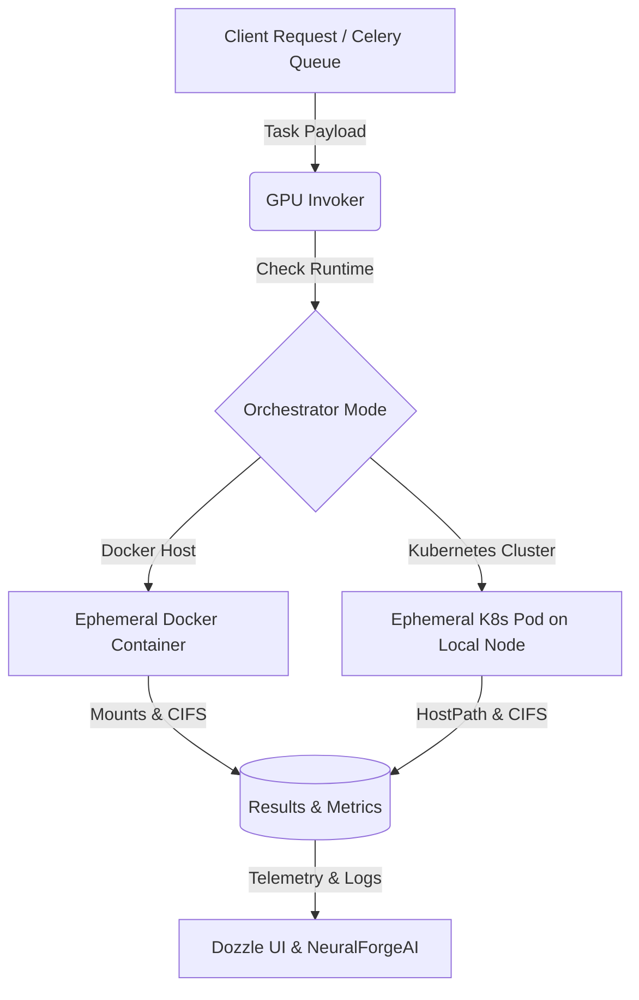

<p align="center">
  <a href="https://linkedin.com/in/wisrovi-rodriguez"></a>
  <a href="https://wisrovi.dev"></a>
  <a href="https://orcid.org/0009-0005-0710-1861"></a>
  <a href="https://opensource.org/licenses/MIT"></a>
  
</p>

# GPU Invoker (Hive Worker)

> The Celery-based worker node that manages GPU allocation, container lifecycle, and network storage mounting.

## Key Features
- **Configurable Training Time (`train.time`) & Cascading Timeouts (`1.3x` / `2.0x`)**: Honors optional `train.time` (in hours) from the training YAML. When omitted, Ultralytics trains by `epochs` while the Invoker watchdog defaults to `15.6h` (`12h + 30%` post-train margin = `56,160s`) and Redis TTLs default to `24h` (`86,400s`). When `train.time` is provided (e.g., `30`), Ultralytics trains cleanly for `30h`, the Docker/K8s Pod watchdog scales to `1.3x` (`39.0h` = `140,400s`, with a minimum `+45m` post-train floor), and Redis TTLs scale to `2.0x` (`60.0h` = `216,000s`).
- **Graceful Node Drain & Workload Eviction**: Dynamic detection of node-level drain commands (`invoker:{worker_ip}:drain` and `invoker:{worker_ip}:cancel_active`), instantly aborting executing training containers or pods and releasing GPU allocation.
- **High Performance & Hybrid Execution**: Native dual orchestration supporting ephemeral Docker containers and Kubernetes Pods pinned to local worker nodes.
- **Real-Time Task Cancellation & Abort**: Dynamic monitoring of Redis cancellation keys (`wyolo:task:{task_id}:cancel`, `study:{study_id}:cancel`) terminating Docker containers (`container.kill()`) or K8s Pods in seconds upon user request.
- **Dynamic & Multi-GPU Allocation**: Automated detection of optimal GPU index based on highest free VRAM via `nvidia-smi`, with multi-device (`0,1`) and `all` distributed training support.
- **Real Hardware & GPU Telemetry**: Live extraction of compute utilization (%) and VRAM metrics in Docker and K8s environments written directly to Redis and `telemetry.json`.
- **Pre-Flight GPU Health Checks**: Automated hardware verification before task dispatch, pausing public queues if the NVIDIA driver or PCIe bus experiences errors (preventing queue burn).
- **Node Vitality Heartbeat & Storage Guard**: Real-time 30-second TTL heartbeat (`invoker:{worker_host}:heartbeat`) renewed every 10s, coupled with continuous disk space monitoring of `/home/wyolo` (< 5% critical pause).
- **Startup Orphan Sweeper**: Automated purge of lingering or orphaned executor containers and Pods upon invoker boot.
- **Enterprise Security**: Scanned with Bandit, zero exposed credentials.
- **Concurrency & Duplicate Prevention**: Extended Redis visibility timeout (24h) and atomic distributed task locks to eliminate redundant task re-executions.

## Technical Stack & Key Libraries
- **Language & Runtime:** Python 3.10 / 3.13 (`python:3.10-slim`, `python:3.13-slim`)
- **Distributed Task Execution:** Celery (Redis broker & result backend)
- **Container & Cluster Orchestration:** Docker SDK (`docker-py`), Kubernetes in-cluster REST API (`requests`), Dozzle Web Log Streamer
- **Hardware Telemetry & Accelerator Monitoring:** NVIDIA System Management Interface (`nvidia-smi`), K8s Metrics Server API (`metrics.k8s.io/v1beta1`), `pynvml`
- **Hyperparameter Tuning:** Optuna with dedicated PostgreSQL backend (`optuna_db`)
- **Networking & Storage:** Samba (CIFS) with host mounts for datasets, results, events, and request configs
- **Telemetry & Terminal UI:** Redis, Rich (`Console`, `Table`, `Panel`), PyYAML

## Architecture & Workflow



### Hybrid Sequential Execution Process (Docker & Kubernetes)
During the lifecycle of a training task on a worker node, the Invoker orchestrates the execution using strictly sequential, ephemeral containers (in Docker mode) or Pods (in Kubernetes mode) spawned from the `executor` image. This guarantees environment isolation and memory recycling between phases:

1. **Phase #1 (EDA Phase - `eda.py`)**:
   First, an ephemeral container/pod is launched to mount the shared network storage and execute the `DatasetAnalyzer`. It extracts dataset physical characteristics, distribution, bounding box metrics, and generates the initial Exploratory Data Analysis reports (`EDA_Report.docx`, `.md`, and plots). Upon completion, this container/pod is destroyed.
2. **Phase #2 (Training & LLM Phase - `run_training.py`)**:
   Immediately after a successful EDA, a second container/pod is spawned with strict GPU limits and permissions to run the heavy training (`trainer_wrapper.py`). In Kubernetes mode, it is pinned directly to the local node (`spec.nodeName: WORKER_HOSTNAME`) with full Dozzle visibility and 1-click web deletion support. It trains the model, saves weights, logs all results and EDA artifacts to MLflow, and executes the local OpenCode LLM integration to write the final `llm.md` insights report. Upon completion, this container/pod is destroyed.
3. **Passive Reading Phase (`llm_analizer.py`)**:
   The final pipeline state does *not* create a third container. The Invoker natively reads the `llm.md` report from the shared volume generated by Phase #2, injecting its content into the Celery task state for the UI and API to render.

## Installation & Setup
```bash
git clone <repository_url>
cd wyoloservice2_invoker
# Create virtual environment if applicable
python3 -m venv .venv
source .venv/bin/activate
# Install dependencies
make install || pip install -r requirements.txt
```

## Running Tests
To run the unit tests in a clean and consistent Docker environment:
```bash
bash app/run_tests.sh
```

To calculate code coverage using `pytest-cov` locally:
```bash
cd app
bash coverage.sh
```

## Configuration
Configuration is managed via `control_host.env` and `config.yaml` files. Never commit secrets directly to the codebase.

> [!IMPORTANT]
> For compatibility with **Watchtower** and auto-updates across the 70+ active host deployments, the physical Docker Hub image tag must remain strictly **`wisrovi/train_service:worker_invoker_v1.0.0`**, regardless of the internal logical version (e.g. `v1.3.0`).

## ⚙️ Resource Allocation & Limits (Executor)
To prevent the host machine from freezing or crashing during heavy YOLO trainings, the ephemeral **Executor** container is spawned with strict hardware limits:

*   **CPU Limits (`nano_cpus`)**: Restricts processing power based on `WORKER_CPU_CORES_AVAILABLE` (or `WORKER_CPU_CORES`) defined in `user.env`. Docker restricts CPU cycles at the kernel level, leaving the remaining cores available for the host OS and the Invoker daemon.
*   **RAM Limits (`mem_limit`)**: Enforces memory usage bounds using `WORKER_RAM_MEMORY` from `user.env`.
*   **Shared Memory (`shm_size`)**: Vital for PyTorch dataloaders and multi-process training:
    *   **Minimum Limit**: Strictly bounded to a **minimum of 16 GB** to prevent Out Of Memory (OOM) errors during dataloading.
    *   **Dynamic Scaling**: If `WORKER_RAM_MEMORY` is set to a value higher than 16 GB (e.g., `28g`), SHM scales up to match that RAM allocation. Otherwise, it defaults to `16g` while RAM limits remain at the custom lower value.

## Usage
```bash
# Start the service
make start_all || docker-compose up -d

# Pause public queues (gpus_high, gpus_medium, gpus_low) to listen ONLY to the private queue
make pause-public-queues

# Resume public queues to listen to all queues again
make resume-public-queues

# Remotely pause public queues for a specific worker node with options (temporal or perpetual)
python3 test/manage_remote_worker.py --ip 192.168.1.68 --action pause --mode temporal --hours 4
python3 test/manage_remote_worker.py --ip 192.168.1.68 --action pause --mode perpetual

# Remotely resume public queues for a specific worker node
python3 test/manage_remote_worker.py --ip 192.168.1.68 --action resume

# Stop local development service
make stop

# Stop local service AND clean up any orphan executors or production containers
make stop-all
```

---

## 📜 Changelog & Version History

### Version 2.3.0 (Current Release) - 2026-10-23
*   **Configurable `train.time` & Cascading Timeouts (`1.3x` Invoker / `2.0x` Redis):** Added `parse_user_train_time_hours` and `resolve_training_timeouts` in `app/states/run_training.py`. Omits `time` from Ultralytics config when not defined by the user (preserving epoch-based training) and injects `time` when `> 0`. Scales Docker wait and Kubernetes Pod `activeDeadlineSeconds` to `1.3x` (minimum `+45m` floor for post-train) and scales Redis task locks and study metadata TTLs to `2.0x` (minimum `24h`). Raised Celery `visibility_timeout` and `result_expires` to 7 days (`604,800s`).

### Version 2.1.0 - 2026-10-21
*   **Live Task Cancellation & Abort:** Supports immediate interruption via Redis keys (`wyolo:task:{task_id}:cancel`, `study:{study_id}:cancel`). Dynamically intercepts Docker containers (`SIGTERM`/`SIGKILL`) and K8s Pods, marking Optuna and execution states as `cancelled`.
*   **Real Telemetry Collection:** Replaced stubbed metrics with real-time host/container GPU utilization and VRAM polling via `nvidia-smi` and Kubernetes Metrics Server API.
*   **Dynamic & Multi-GPU Assignment:** Extended orchestrators with `get_optimal_gpu_device` to automatically route jobs to GPUs with the lowest memory usage or honor user-defined configurations (`gpu_id: "0,1"` or `"all"`).
*   **Startup Orphan Container Sweeper:** Automatically detects and purges lingering `wyolo_executor_*` and `wyolo_eda_runner_*` containers or Pods on worker startup.
*   **Pre-Flight GPU Health Diagnostics:** Validates hardware accessibility before consuming training jobs, pausing worker execution if GPUs are offline or inaccessible.
*   **Node Vitality Heartbeat & Storage Guard:** Registers an active Redis heartbeat (`invoker:{worker_host}:heartbeat`) renewed every 10s and enforces storage quota safety checks on `/home/wyolo` (< 5% threshold).
*   **Unified Queue Support:** Subscribes workers to both host-specific private queues and the generic cluster queue `wyolo_gpu_queue`.

### Version 1.9.9 - 2026-10-20
*   **Kubernetes Pod Terminal State Wait (`orchestrator.py`):** Explicitly awaits terminal Pod phases (`Succeeded` or `Failed`) and retrieves the actual container exit code, strictly prohibiting premature assumptions of `exit_code=0` when the log stream closes while the Pod remains in `Running` state.
*   **Resilient Auto-Reconnecting Log Stream:** Wraps Kubernetes log streaming in a reconnection loop with `sinceSeconds` offset pagination, preventing stream drops or socket timeouts from interrupting execution or losing logs.
*   **Temporal and Status Metric Contract Enforcement (`run_training.py`):** Rejects stale `results.json` files generated prior to trial execution and validates that results contain a completed status, preventing fake `0.0` accuracy metrics from polluting Optuna HPO studies.
*   **Automatic MLflow Zombie Run Cancellation:** Catches unhandled executor failures or aborts to immediately update active MLflow runs to `status: FAILED`.
*   **Version Update to v1.9.9:** Bumped invoker core version to `v1.9.9` and `RunTraining` to `1.0.5`.

### Version 1.9.5 - 2026-10-06
*   **Hybrid Orchestration Architecture (`orchestrator.py`):** Introduced dual orchestration engine supporting both standalone Docker hosts and native Kubernetes clusters (`k8s`/in-cluster ServiceAccount).
*   **Kubernetes Pod Lifecycle & Node Pinning:** In Kubernetes mode, tasks are spawned directly as ephemeral Pods (`v1.Pod`) pinned to the local node (`spec.nodeName: WORKER_HOSTNAME`) with GPU, RAM, CPU, and SHM limits.
*   **Dozzle Web UI Real-Time Streaming & 1-Click Pod Deletion:** Live container and pod logs stream directly into Dozzle (`http://localhost:8888`), allowing web users without terminal access to monitor or delete running executor pods with a single click.
*   **State Refactoring:** Modernized `EDA` and `RunTraining` states to use `get_orchestrator()` factory.
*   **Version Update:** Bumped invoker version to `v1.9.5`.

### Version 1.9.4 - 2026-08-25
*   **LLM Model Fix:** Replaced dead `opencode/deepseek-v4-flash-free` with `opencode/nemotron-3.5-lightning-free` in training report analyzer. Model configurable via `LLM_MODEL` env var.
*   **Version Update:** Bumped invoker version to v1.9.4.

### Version 1.9.3 - 2026-08-25
*   **Optuna study naming fixed:** `optuna_search` now reads the study name from `sweeper.study_name` (falling back to top-level `study_name`, then the dated default). The user-provided name was previously read from the wrong nesting level, so every run created a fresh `study_YYYYMMDD_<hash>` study and Optuna lost its cross-run trial history (warm-start).
*   **Version Update:** Bumped invoker version to v1.9.3.

### Version 1.9.2 - 2026-08-24
*   **Optuna storage moved to dedicated DB:** `optuna_search` now stores studies in `postgresql://...:23436/optuna_db` instead of the shared `wyoloservice` DB. The shared DB is also used by MLflow, whose Alembic migrations overwrite the generic `alembic_version` table (revision `da6fb0208061`) and made Optuna abort every study creation with "The runtime optuna version 4.8.0 is no longer compatible with the table schema". This aligns the invoker with the manager, which already used `optuna_db`.
*   **Gradio launcher DB aligned:** `UI/gradio_launcher/db.py` default URL now points to `optuna_db` as well.
*   **EDA dataset path translation:** The temporary EDA executor container has no `/datasets` root path (the CIFS share mounts at `/wyolo/control_server/datasets`). `EDA` now translates user-facing `/datasets/...` paths to `/wyolo/control_server/datasets/...` before running `DatasetAnalyzer`, fixing the `FileNotFoundError` seen on the Bus-Dron segmentation training.
*   **Version Update:** Bumped invoker version to v1.9.2.

### Version 1.9.1 - 2026-08-06
*   **LLM Analyzer Compatibility:** Updated expected LLM report filename to LLM_Report.md to align with the new executor output format.
*   **Version Update:** Bumped invoker version to v1.9.1.

### Version 1.8.6 - 2026-08-05
*   **LLM report generation moved to the executor:** The OpenCode analysis now runs inside the executor container, which writes `llm.md` into the shared results directory and uploads it to MLflow as an artifact.
*   **Invoker LLM analyzer is now a passive reader:** `LlmAnalizer` no longer calls OpenCode; it reads `/home/wyolo/train_service_results/llm.md` and exposes the content through the Celery task state (`llm_report`), keeping MCP `get_study_details` compatible.
*   **Gradio renders llm.md directly:** `_llm_status` reads `/results/llm.md` as the primary source when the task succeeds, falling back to the `llm_report` from the task result.
*   **Version Update to v1.8.6:** Bumped version to `v1.8.6`.

#### Gradio UI Launcher Update (v1.2.2) - 2026-08-05
*   **Header cleanup:** Removed the word "Gradio" from the header title; the version now renders on its own line below the tagline ("Train YOLO on this GPU node • Config persisted in Redis • Real-time automatic monitoring") instead of inline in the title.
*   **Version Update to v1.2.2:** Bumped gradio launcher version to `v1.2.2`.

### Version 1.8.5 - 2026-08-05
*   **GPU monitoring inside the executor container:** `get_gpu_usage` now runs `nvidia-smi` via `docker exec wyolo_executor` with a 5-second timeout, so utilization is reported from the executor environment instead of the host.
*   **Invoker ID fallback to PRIVATE_QUEUE:** `WORKER_NAME` env now falls back to `PRIVATE_QUEUE` when not set, keeping the correct invoker identity in logs and task metadata.
*   **CUDA-based invoker base image:** The invoker Dockerfile now builds on `nvidia/cuda:12.4.0-devel-ubuntu22.04` with Python 3.10 (removing `nvidia-utils-535`, which is provided by the base CUDA image).
*   **Gradio launcher 3-column mode toggle:** `toggle_mode` now switches between the example, upload, and saved-template columns; removed the obsolete Task ID edit toggle.
*   **Docker Compose cleanup:** Removed the `host.docker.internal` extra host mapping and tidied GPU capability formatting.
*   **Version Update to v1.8.5:** Bumped version to `v1.8.5`.

### Version 1.8.4 - 2026-08-04
*   **Fix LLM/OpenCode hanging with timeout + fallback:** Added 180-second timeout to OpenCode subprocess; when the free model hangs, a fallback report is auto-generated from CSV metrics so tasks complete successfully.
*   **LLM Analysis Report now visible in Gradio UI:** Task state updated with LLM report (from OpenCode or fallback) after post-training pipeline; Gradio Monitoring tab displays report with copy-to-clipboard button.
*   **Full English UI:** All Gradio user-facing texts translated to English (header, monitoring, accordions, buttons, placeholders).
*   **Invoker ID fix confirmed:** Worker correctly reports private queue IP (192.168.1.68) in logs and task metadata.
*   **Version Update to v1.8.4:** Bumped version to `v1.8.4`.

### Version 1.8.3 - 2026-08-04

### Version 1.8.2 - 2026-08-04

### Version 1.8.1 - 2026-08-04
*   **LLM Analysis Report copy button:** Added copy-to-clipboard button with visual feedback (✅ Copied! / ❌ Failed) on the LLM Analysis Report in Monitoring.
*   **My Templates view redesign:** Restructured into Load/Save sections with professional CSS styling (`.template-section` with hover effects, borders, shadows).
*   **English UI with proper formatting:** All user-facing text translated to English; step-by-step instructions with line breaks for readability.
*   **ZIP download fix:** Removed broken `gr.update(interactive=...)` timer tick; DownloadButton now always interactive, returns None when no results.
*   **Resource dashboard & GPU monitoring:** Fixed GPU utilization by querying `nvidia-smi` from the executor container.
*   **Version Update to v1.8.1:** Bumped version to `v1.8.1`.

### Version 1.8.0 - 2026-08-04

### Version 1.7.8 - 2026-08-04
*   **Add sweeper.fitness to Gradio Templates:** Added the `fitness` metric key to the classification (`metrics/accuracy_top1`) and detection (`metrics/mAP50(M)`) quick templates. The executor's `train_model` step requires `sweeper.fitness`; without it the pipeline aborted with `[Error Code: 502] La clave 'fitness' no se encuentra en la configuración del sweeper.` and finished with exit code 0 without writing `results.json`.
*   **Version Update to v1.7.8:** Bumped version to `v1.7.8`.

### Version 1.7.7 - 2026-08-04
*   **Fix Dataset Paths in Gradio Templates:** Corrected the classification, detection, and segmentation quick templates to point to the bundled `/examples/` datasets (the old `/datasets/` paths did not exist on the cluster share, causing the executor to abort early without writing `results.json`).
*   **Version Update to v1.7.7:** Bumped version to `v1.7.7`.

### Version 1.7.6 - 2026-08-04
*   **One-Click Training Dispatch:** Gradio launcher now validates the YAML and dispatches the Celery training task on the Train button click, auto-switching to the Monitoring tab.
*   **Results ZIP Download:** Added a "Download Results ZIP" button to fetch the training results archive from the worker.
*   **Auto-Refresh Metrics:** Training metric plots now auto-refresh on the status timer tick, in addition to the manual refresh button.
*   **Version Update to v1.7.6:** Bumped version to `v1.7.6`.

### Version 1.7.5 - 2026-08-03
*   **EDA Python command fix:** Resolved syntax error in docker command by changing container command structure to a clean argv list.
*   **Version Update to v1.7.5:** Bumped version to `v1.7.5`.

#### Gradio UI Launcher Updates (v1.1.0) - 2026-08-04
*   **Shared Redis Templates Store:** Moved Classification, Detection, and Segmentation templates to the centralized `invoker:shared_templates` hash in Redis.
*   **Local Saved Template Path:** Local configs saved via "Save Template" are persisted under `invoker:<ip>:template_invoker` to avoid conflicts.
*   **Prominent Destination Queue Banner:** Added a styled, prominent status bar showing the resolved private queue IP at the very top.
*   **Execution Mode Descriptions:** Clearly documented the differences between Simple Training and Full Pipeline modes.
*   **Glassmorphic cockpit design:** Styled the Gradio application with a gorgeous dark theme.

### Version 1.7.4 - 2026-08-03
*   **EDA Temporary Executor Container:** Runs dataset analysis in a short-lived sibling executor container to safely mount network folders and analyze datasets before training.
*   **Version Update to v1.7.4:** Bumped version to `v1.7.4`.

### Version 1.7.3 - 2026-08-03
*   **OpenCode LLM Model Tuning:** Configured `TrainingReportAnalyzer` to use `opencode/deepseek-v4-flash-free` for report generation.
*   **OpenCode Diagnostics Logs:** Prints exit codes and output logs (stdout/stderr) during OpenCode execution.
*   **Version Update to v1.7.3:** Bumped version to `v1.7.3`.

### Version 1.7.2 - 2026-08-03
*   **Dataset Analyzer & OpenCode AI Reports:** Integrated `DatasetAnalyzer` in `EDA` and `TrainingReportAnalyzer` (via OpenCode local LLM execution) in `LlmAnalizer`.
*   **Live Resource Telemetry:** Spawns a background thread in `docker_run` to monitor container CPU, RAM, and GPU stats, exporting them to `telemetry.json` in the results directory.
*   **Gradio Task Checker Panel:** Restructured the Gradio launcher UI to add Live Telemetry readout and a Task Status verification tab (querying Celery AsyncResult).
*   **Version Update to v1.7.2:** Bumped version to `v1.7.2`.

### Version 1.7.1 - 2026-08-03
*   **Fix Default Timeout Inconsistency:** Synchronized default executor timeout to 12 hours (43200 seconds) in `run_training.py` and added configurable option `executor_timeout_seconds` in `config.yaml`. Bumped global version to `v1.7.1`.

### Version 1.5.0 - 2026-07-31
*   **Version Update to v1.5.0:** Bumped core invoker version to reflect recent telemetry, startup registry, and micro-train features.

### Version 1.3.4 - 2026-07-31
*   **Massive Docker Broadcast Pull Command:** Registered a new custom Celery remote control handler (`force_docker_pull`) inside the worker invoker to enable fast, massive cluster-wide image pulling.

### Version 1.3.3 - 2026-07-29
*   **Enforce Minimum SHM Memory Rule:** Implemented specific business logic to set shared memory (`shm_size`) to a minimum of 16 GB. If the user allocates more RAM in `WORKER_RAM_MEMORY` within `user.env` (e.g. `28g`), that larger value is applied for both RAM and SHM; otherwise, SHM defaults to `16g` while RAM respects the custom lower limit.
*   **Rich Telemetry Registration in Redis:** Upgraded task startup blocks to retrieve detailed host environment configurations (`WORKER_HOST`, `WORKER_HOSTNAME`, `WORKER_OS`, `WORKER_CPU_CORES`, `WORKER_GPU_COUNT`, `WORKER_GPU_MODEL`) and store them in Redis under the dedicated `study:<study_id>:invoker_details` key as JSON, as well as embedding these details in the `active_trial` metadata and classic `invoker` string.
*   **Startup Metadata Registration:** Configured worker startup signal handler to serialize host hardware specs, software parameters, and version metadata into a Redis key named `invoker:<ip>:version` on every worker boot.
*   **Micro Train Helper in Container:** Ported 'micro_train.sh' script to run natively inside the invoker container at '/usr/local/bin/micro_train' by installing Docker CLI client within the invoker's Docker image.

### Version 1.3.2 - 2026-07-29
*   **Executor Resource Allocation Fix:** Resolved inconsistencies when mapping CPU and RAM limits to the ephemeral Executor container in [app/states/run_training.py](file:///home/william.rodriguez/Documents/w_libraries/train_service2/wyoloservice2_invoker/app/states/run_training.py). Unified resource detection to support both `WORKER_CPU_CORES_AVAILABLE` and `WORKER_CPU_CORES` across development and production hosts. Integrated robust memory parsing (supporting units like `28g`) to pass strict byte counts for container limits (`mem_limit` and `shm_size`), aligning logs with Docker runtime restrictions.

### Version 1.3.1 - 2026-07-29
*   **Persistent Pause Options (Temporal & Perpetual):** Upgraded [app/worker_gpu.py](file:///home/william.rodriguez/Documents/w_libraries/train_service2/wyoloservice2_invoker/app/worker_gpu.py) to monitor dynamic state keys in Redis. Added support for temporal pause (automatically resuming after X hours, default 4 hours configurable via `pause_duration_hours` in [app/config.yaml](file:///home/william.rodriguez/Documents/w_libraries/train_service2/wyoloservice2_invoker/app/config.yaml)) and perpetual pause (which persists across worker restarts).
*   **Remote Worker Management Upgrade:** Enhanced [test/manage_remote_worker.py](file:///home/william.rodriguez/Documents/w_libraries/train_service2/wyoloservice2_invoker/test/manage_remote_worker.py) to support `--mode` (`temporal` or `perpetual`) and `--hours` CLI arguments to set persistent pause states in Redis.

### Version 2.0.0 - 2026-07-03
*   **Watchtower API Compatibility Fix:** Configured `DOCKER_API_VERSION=1.44` for the watchtower service in both active host deployment `/home/wisrovi/scripts/docker-compose.yaml` and repository template [production/docker-compose.yaml](file:///home/william.rodriguez/Documents/w_libraries/train_service2/wyoloservice2_invoker/production/docker-compose.yaml) to resolve the Docker API protocol version mismatch error.
*   **Orphan Container Cleanup Rule:** Added the `stop-all` command in the [Makefile](file:///home/william.rodriguez/Documents/w_libraries/train_service2/wyoloservice2_invoker/Makefile) to force stop and clean up programmatically created executor containers (`wyolo_executor_*`) and instances running under the systemd production scope.
*   **Celery Node Hostname Fix:** Assigned explicit `hostname: wyolo_invoker_${WORKER_HOST}` in [docker-compose.yaml](file:///home/william.rodriguez/Documents/w_libraries/train_service2/wyoloservice2_invoker/docker-compose.yaml) to ensure Celery registers the worker with its actual IP address instead of Docker's random short container ID hostname (e.g., `celery@45fa662f178a`).
*   **Remote Worker Management CLI:** Programmed [test/manage_remote_worker.py](file:///home/william.rodriguez/Documents/w_libraries/train_service2/wyoloservice2_invoker/test/manage_remote_worker.py) to allow administrators and external services (like the Manager) to dynamically add or cancel consumer queues for any worker node in the network by sending targeted Celery control messages via Redis from the outside, without accessing the worker's host or container.
*   **Dynamic Queue Consumer Control:** Added shell scripts and Makefile rules (`pause-public-queues`, `resume-public-queues`) to dynamically pause and resume listening to public queues (gpus_high, gpus_medium, gpus_low) using Celery control broadcast commands isolated to the local node hostname.
*   **Test Environment Alignment:** Updated [test/send_to_invoker_directly.py](file:///home/william.rodriguez/Documents/w_libraries/train_service2/wyoloservice2_invoker/test/send_to_invoker_directly.py) queue targets and corrected [test_to_send_invoker.yaml](file:///home/william.rodriguez/Documents/w_libraries/train_service2/wyoloservice2_invoker/test_to_send_invoker.yaml) dataset paths to point to real Samba storage resources, enabling successful end-to-end integration tests.
*   **Config Serialization Fix:** Added recursive data serialization/sanitization in [app/states/run_training.py](file:///home/william.rodriguez/Documents/w_libraries/train_service2/wyoloservice2_invoker/app/states/run_training.py) to strip non-serializable objects (like `_thread.RLock` and internal metadata injected by wpipe) before writing to YAML/JSON configs for the executor.
*   **Optuna Trial Interface Fix:** Patched [app/worker_gpu.py](file:///home/william.rodriguez/Documents/w_libraries/train_service2/wyoloservice2_invoker/app/worker_gpu.py) to correct the signature mismatch where Optuna's `Trial` object was incorrectly passed directly to the pipeline. Implemented dynamic parameter sampling from the YAML search space and configuration merging before executing training runs.
*   **Startup Logging Markup Fix:** Corrected rich log syntax errors inside [app/celery_config.py](file:///home/william.rodriguez/Documents/w_libraries/train_service2/wyoloservice2_invoker/app/celery_config.py) to prevent container crashes caused by unmatched tags during print_table invocations.
*   **Start Configuration Fix:** Patched [production/config.py](file:///home/william.rodriguez/Documents/w_libraries/train_service2/wyoloservice2_invoker/production/config.py) to look for the control host environment configuration inside the `config/` folder, avoiding GUI locks during execution of headless `make start` routines.
*   **Dynamic CPU allocations:** Upgraded [app/states/run_training.py](file:///home/william.rodriguez/Documents/w_libraries/train_service2/wyoloservice2_invoker/app/states/run_training.py) to read `WORKER_CPU_CORES_AVAILABLE` dynamically from environment instead of using a hardcoded 8 cores limit, ensuring executor container resource limits are respected.
*   **Rich Log Interface:** Integrated `rich` components (Console, Panel, Table) inside [app/celery_config.py](file:///home/william.rodriguez/Documents/w_libraries/train_service2/wyoloservice2_invoker/app/celery_config.py) and [app/worker_gpu.py](file:///home/william.rodriguez/Documents/w_libraries/train_service2/wyoloservice2_invoker/app/worker_gpu.py) to output beautifully formatted startup parameters, trial execution details, and critical host configuration environments (like CPU, RAM, and GPU limits) directly to logs.
*   **Dependency Version Pinning:** Pinned all Python dependencies in [app/requirements.txt](file:///home/william.rodriguez/Documents/w_libraries/train_service2/wyoloservice2_invoker/app/requirements.txt) to specific production-tested versions (including `optuna==4.8.0`) to avoid potential version mismatches or breaking changes in future deployments.
*   **Dynamic image pulling:** Configured the container runner state to use `pull="always"` for executor runs, guaranteeing active worker nodes always use the latest built Docker Hub layers.
*   **Optuna cancellation routing:** Integrated Celery termination listener to intercept `study.stop()` tasks.
*   **Docker-in-Docker subprocess mounts:** Upgraded Docker API handler to mount Samba CIFS `/wyolo/worker` shares dynamically before launching training trials.

### Version 1.0.0 (Initial Release) - 2026-02-10
*   FastAPI / Celery task listener pulling classification jobs.

---
## Knowledge Graph (Graphify)
This project features a Graphify-powered knowledge graph located in the `graphify-out/` directory.

### Commands & Usage
- **Query the codebase**: Run `graphify query "<your question>"` to trace concepts and code structures.
- **Explain a concept**: Run `graphify explain "<concept>"` to get a detailed summary.
- **Find paths**: Run `graphify path "<A>" "<B>"` to discover relationships between two symbols.
- **Incremental update**: Run `graphify update .` to keep the graph in sync after editing code (AST-only, cost-free).

### Artifacts & Visualizations
- [graph.html](file:///home/william.rodriguez/Documents/w_libraries/train_service2/wyoloservice2_invoker/graphify-out/graph.html): Interactive graph visualization. Open directly in any browser.
- [GRAPH_REPORT.md](file:///home/william.rodriguez/Documents/w_libraries/train_service2/wyoloservice2_invoker/graphify-out/GRAPH_REPORT.md): Text-based audit report including architectural hubs, communities, and potential knowledge gaps.

---

---

## 👤 Author & Afiliación Official

* **William Steve Rodriguez Villamizar (Wisrovi)**
* **Cargo:** Principal AI Engineer & Applied AI Solutions Architect | Scientific Researcher
* 📧 **Email:** [wisrovi.rodriguez@gmail.com](mailto:wisrovi.rodriguez@gmail.com)
* 🌐 **Portal Official:** [wisrovi.dev](https://wisrovi.dev)
* 💼 **LinkedIn:** [wisrovi-rodriguez](https://www.linkedin.com/in/wisrovi-rodriguez/)
* 🆔 **ORCID:** [0009-0005-0710-1861](https://orcid.org/0009-0005-0710-1861)
* 📦 **PyPI:** [pypi.org/user/wisrovi/](https://pypi.org/user/wisrovi/)
* 🐙 **GitHub:** [@wisrovi](https://github.com/wisrovi)


## Licensing and Usage

This project uses a **PolyForm Noncommercial License** model:
- **Community/Research**: Licensed under the PolyForm Noncommercial. See [LICENSE](LICENSE).
- **Commercial**: Requires a commercial license. See [COMMERCIAL.md](COMMERCIAL.md) for details.

### Academic Research
If you use this project in academic research, you are required to cite this repository using the provided `CITATION.cff` and notify the author with a link to your publication.


## Changelog
- **v2.3.1 (2026-10-26)**: Made `nvidia-smi` invocation defensive in Executor launch commands (`(command -v nvidia-smi >/dev/null 2>&1 && nvidia-smi || true)`) to prevent premature exit code 127 in Kubernetes environments where `nvidia-smi` is not mounted.
- **v1.9.9 (2026-10-20)**: Added dynamic float-to-integer string sanitization for `MAX_GPU` environment variable passed to Executor containers and Pods to prevent downstream integer parsing errors.
- **v1.9.8 (2026-10-19)**: Enhanced Kubernetes execution resilience by injecting ConfigMap (`train-service-global-config`) and Secrets (`train-service-secrets`) `envFrom` references into ephemeral Executor Pod manifests, adding defensive cluster defaults for `CONTROL_HOST` and CIFS Samba credentials, and implementing automatic failure log capture on non-zero exit codes.
- **v1.9.7 (2026-10-07)**: Added GPU memory telemetry (`worker_gpu_memory` and `physical_gpu_memory_total`) in Redis metadata registration with automatic `nvidia-smi` fallback detection.
- **v1.9.6 (2026-10-07)**: Added dynamic resources Hash registration (`invoker:<worker_ip>:resources`) in Redis on startup and runtime dynamic limits injection (`MAX_GPU`, RAM, CPU cores) in `run_training.py` without restarting containers.
- Bumped version due to License update to PolyForm Noncommercial and Dual Licensing model.
